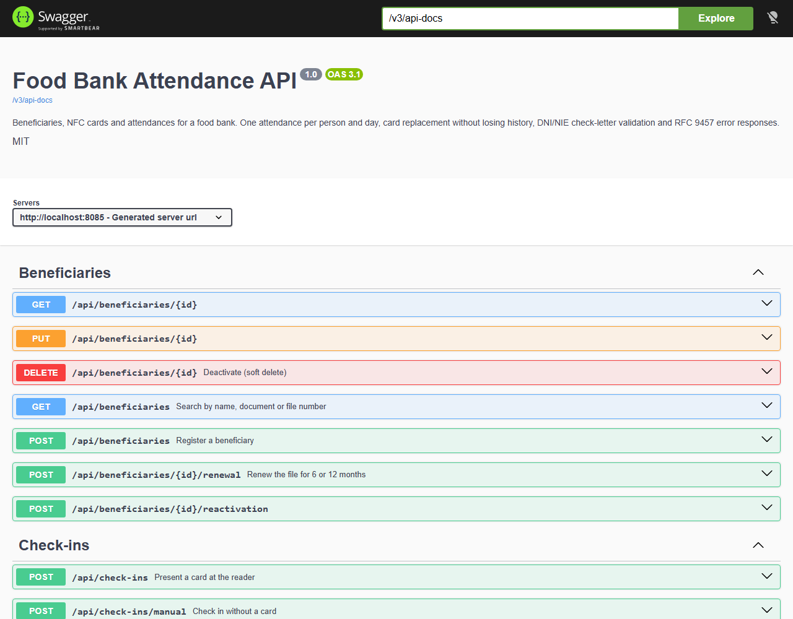
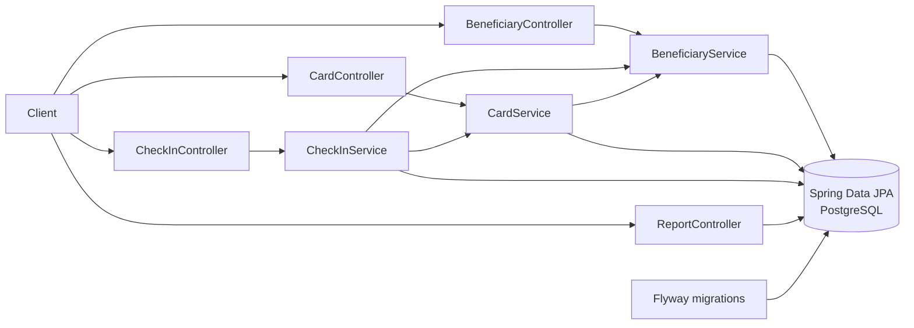

# Food Bank Attendance API

A REST API for running a food bank's front desk: registering beneficiaries, issuing NFC cards and recording one attendance per person per day.


## Background

I built [Sonrisas NFC](https://github.com/rafaromerodev/sonrisas-nfc), a desktop app in use at a non-profit food bank in the Canary Islands since 2025. Auditing its first version against real data taught me where this kind of system goes wrong: a card left on the reader logged a visit every 1.5 seconds, a lost card meant losing the person's history, and expired files went unnoticed.

This project takes those same business rules and implements them as a backend service in Spring Boot and PostgreSQL. It is the kind of API a web or mobile front desk, or several sites sharing one database, would need. It runs on fictional data only.

<p>
  
</p>

## Business rules, and where they are enforced

| Rule | How |
|---|---|
| **One attendance per person per day**, however many times the card is tapped | Checked in `CheckInService`, and guaranteed by a `unique (beneficiary_id, attended_on)` constraint in PostgreSQL, so a race between two requests can't double count |
| **Replacing a lost card keeps the history** | Attendances belong to the beneficiary, not to the card. Cards are deactivated with a reason (`LOST`, `STOLEN`, `DAMAGED`), never deleted |
| **A UID is active for one person only, and a person has at most one active card** | Two partial unique indexes: `unique (uid) where deactivated_at is null` and the same for `beneficiary_id` |
| **A replaced card is recognised if it shows up again** | `DEACTIVATED_CARD` outcome, returned with the owner, instead of "unknown card" |
| **Expired files need staff confirmation** | `FILE_EXPIRED` outcome records nothing until the request is repeated with `confirmExpired: true` |
| **DNI/NIE typos are caught** | The check letter is validated and the correct one suggested: `"Wrong check letter. Did you mean 12345678Z?"` |
| **Correcting a document never loses history** | The primary key is a surrogate `id`, not the document |
| **Deleting a person doesn't change past reports** | Soft delete (`active = false`) with reactivation |

## API overview

| Method | Path | |
|---|---|---|
| `POST` | `/api/beneficiaries` | Register (validates DNI/NIE check letter) |
| `GET` | `/api/beneficiaries?query=&active=&page=&size=&sort=` | Search by name, document or file number |
| `GET` · `PUT` · `DELETE` | `/api/beneficiaries/{id}` | Read, update (including the document), deactivate |
| `POST` | `/api/beneficiaries/{id}/renewal?months=6\|12` | Renew the file from today or from its current expiry |
| `POST` | `/api/beneficiaries/{id}/reactivation` | Undo a deactivation |
| `POST` · `GET` | `/api/beneficiaries/{id}/cards` | Assign the first card · card history |
| `POST` | `/api/beneficiaries/{id}/cards/replacement` | Replace a card, with a reason |
| `POST` | `/api/check-ins` | Present a card. Returns an explicit outcome |
| `POST` | `/api/check-ins/manual` | Check in without a card |
| `GET` | `/api/beneficiaries/{id}/attendances` | Attendance history |
| `GET` | `/api/reports/summary?from=&to=` | Attendances, people attended, new registrations, expired files |

The full contract is in Swagger UI at `/swagger-ui.html` (OpenAPI 3.1 at `/v3/api-docs`).

### Check-in outcomes

A card read is not just "success or error". The front desk needs to show a different screen for each case, so `POST /api/check-ins` always answers `200` with one of:

`REGISTERED` · `ALREADY_ATTENDED_TODAY` · `FILE_EXPIRED` · `UNKNOWN_CARD` · `DEACTIVATED_CARD` · `INACTIVE_BENEFICIARY`

```http
POST /api/check-ins
{"cardUid": "04 a1:b2-c3"}

200 OK
{"outcome": "REGISTERED",
 "beneficiary": {"id": 1, "document": "12345678Z", "fileStatus": "VALID", ...},
 "attendance": {"id": 7, "attendedOn": "2026-11-17", "source": "CARD"}}
```

UIDs are normalised (`04 a1:b2-c3` becomes `04A1B2C3`), since readers report them in different formats.

### Errors

Every error is an [RFC 9457](https://www.rfc-editor.org/rfc/rfc9457) problem detail. Validation errors list each field:

```json
{"status": 400, "title": "Bad Request", "detail": "Invalid request",
 "errors": {"document": "Wrong check letter. Did you mean 12345678Z?"}}
```

## Design



- **Package by feature** (`beneficiary`, `card`, `checkin`, `report`), each with its entity, repository, service and controller. The HTTP layer only maps requests and responses; every decision lives in the services.
- **The schema is owned by Flyway** (`src/main/resources/db/migration`). Hibernate runs with `ddl-auto=validate`, so it checks the entities against the schema and never changes it.
- **Time is injected.** "Today" decides attendance and expiry, so services read an injected `Clock` in the `Atlantic/Canary` zone, and tests move it forward to check rules such as "a new day allows a new attendance".
- **`open-in-view` is disabled.** Responses are built from data loaded inside the transaction. A test caught a lazy-loading bug on the deactivated-card path because of this.
- **Entities expose no setters.** State changes go through intention-revealing methods (`renew`, `deactivate`, `correctDocument`).

## Running it

**Requirements:** Java 21 and Docker.

```bash
./mvnw spring-boot:run
```

Spring Boot starts PostgreSQL from `compose.yaml`, applies the migrations and serves the API on `http://localhost:8080`. Open `http://localhost:8080/swagger-ui.html`.

### Docker image

```bash
docker build -t food-bank-attendance-api .
docker run -p 8080:8080 \
  -e SPRING_DATASOURCE_URL=jdbc:postgresql://<host>:5432/attendance \
  -e SPRING_DATASOURCE_USERNAME=... -e SPRING_DATASOURCE_PASSWORD=... \
  food-bank-attendance-api
```

The image is multi-stage, runs as a non-root user and has a health check on `/actuator/health`.

## Tests

```bash
./mvnw verify
```

34 tests. The integration tests run the whole application against a real PostgreSQL 17 started by Testcontainers. No H2, no mocks of the database.

| Suite | What it covers |
|---|---|
| `IdentityDocumentsTest` | DNI/NIE normalisation, check-letter suggestions, malformed input |
| `BeneficiaryApiTest` | Registration, field validation errors, duplicates, document correction keeping history, search, renewal rules, expiry warnings, soft delete, 404 problem details |
| `CheckInApiTest` | Every check-in outcome, once-per-day across a day change, UID formats, card replacement, a UID shared by two people, manual check-in, and the database constraint on its own |
| `ReportApiTest` | Period summary and invalid periods |

GitHub Actions runs the suite and builds the Docker image on every push.

## Not included

This is a backend service, not the production system. Authentication and authorisation (e.g. Spring Security with roles for front desk and coordinators), auditing of every change and PDF reports exist in the desktop app and would be the next steps here.

## License

[MIT](LICENSE)
